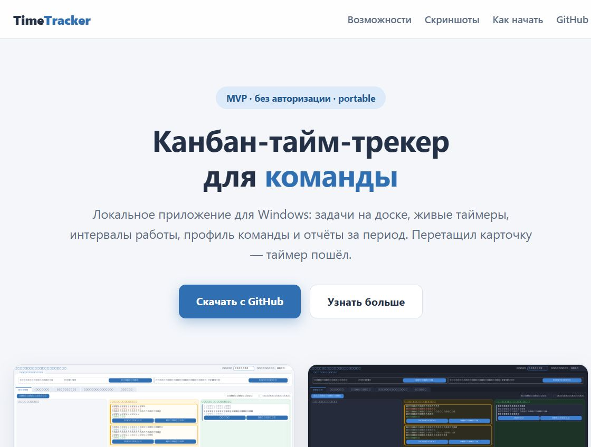

# TimeTracker — канбан-тайм-трекер команды

Локальный тайм-трекер для Windows: **канбан-доска** с карточками задач,
интервалы работы, шаблоны, **профиль команды**, отчёты и две темы оформления.

**MVP без авторизации** — участники переключаются в шапке приложения без
пароля, время записывается на выбранного участника.

🌐 **Сайт проекта:** [трекерзерокод3.рф](https://xn--3-gtbcaaltd9abodcu.xn--p1ai/)

📦 **Передача и деплой:** [docs/HANDOVER.md](docs/HANDOVER.md)

[](https://xn--3-gtbcaaltd9abodcu.xn--p1ai/)

## Возможности

- 🗂 **Канбан-доска** — колонки «Новая / В работе / Завершена»; перетаскивание
  карточки запускает и останавливает таймер (статус всегда выводится из
  интервалов — данные не расходятся с доской).
- 🃏 **Карточки задач** — приоритет, видимость, суммарное и личное время,
  кто работает, живой таймер; двойной клик — полная карточка с действиями.
- ⏱ **Интервалы** — несколько задач одновременно, подтверждение завершения
  с длительностью, heartbeat-восстановление после выключения ПК.
- 👥 **Профиль команды** — название команды, участники (добавить /
  переименовать / удалить без паролей), статистика времени за период.
- 📊 **Отчёты** (по всем участникам за период) и **«Мои записи»** — свои
  записи с фильтрами по датам и задаче.
- 🎨 **Две темы** — светлая и тёмная, переключатель в шапке, выбор
  сохраняется; палитра: синий / янтарь / зелёный / красный.
- 📦 **Portable** — собирается в `.exe` одной командой, без установщика и
  прав администратора.

## Стек

Python 3.11+ · PySide6 (Qt6) · SQLite (WAL) · PyInstaller

## Быстрый старт

```bat
git clone <repo-url>
cd <repo>
pip install -r TimeTracker/requirements.txt
python TimeTracker/main.py
```

Сборка portable-версии:

```bat
cd TimeTracker
build.bat
# результат: dist\TimeTracker\TimeTracker.exe
```

Тесты (20 приёмочных сценариев, UI в offscreen-режиме):

```bat
python tests\test_acceptance.py
```

## Структура

```
├── TimeTracker/            # приложение
│   ├── main.py             # точка входа (--db <path>)
│   └── timetracker/
│       ├── db.py           # схема SQLite (WAL)
│       ├── services.py     # бизнес-логика, аудит, отчёты
│       └── ui/             # доска, карточки, команда, темы (QSS)…
├── tests/test_acceptance.py
└── ТЗ.docx                 # техническое задание
```

Подробности — в [TimeTracker/README.md](TimeTracker/README.md).
